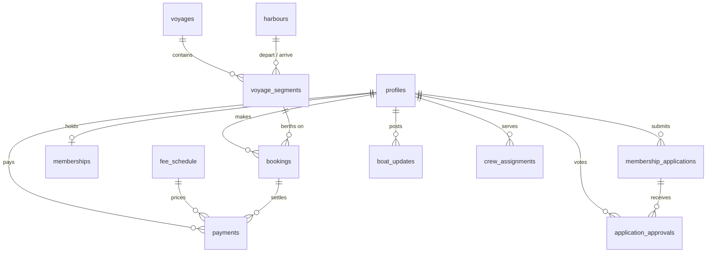

# Nanou Club — Product Requirements Document

**Version 0.2 — approved with Martin's answers · 17 Aug 2026**
**Status: approved — schema applied, Phase 1 in build**

Decisions from review: nanou.org will host the club app (archive moves to stories.nanou.org); repo `mwpicard/nanou-club`; berths are 2 doubles + 4 singles + 1 couch with hot-bunking allowed past capacity at admin's discretion; **fees are set by club vote** — the site publishes running costs transparently and shows only voted amounts; admin approves the first members until two exist, then the 2-member rule takes over; Nanou lies in **Port de Masnou** (home harbour seed). Payments recorded manually until Phase 3; English-first.

---

## 1. Background

NANOU is a 35-ton steel Bruce Roberts cutter, built 1986 in Durban, veteran of two circumnavigations under Bernard — who escaped communist Poland in a ship he built inside a mine — and in harbour, waiting, for two decades. Martin acquired her in a legendary boat swap and now wants to get her sailing again.

**The club** exists to make that happen: paying members fund the recommissioning and running costs (paid crew maintain the boat) and in return join voyages — sailing a leg, or living aboard during a harbour stay.

**The website** is where the club lives: the story, the boat, membership, and an interactive chart where voyages are planned by the skipper and joined by members.

A nice piece of continuity: the 2003 nanou.org itinerary page already said *"CLICK ANYWHERE ON THE BLUE ROUTE LINE TO ZOOM INTO PHOTO-JOURNAL."* The new site keeps that exact interaction, but clicking the route line now **joins the voyage**.

## 2. What we keep from the old attempt

The existing `mwpicard/nanou` repo (nanou.org) is the restored legacy site: ~9,600 files, almost entirely voyage stories and photo galleries from the FrontPage era. Analysis verdict:

- **No reusable app code** — it's a static archive with no auth, data, or booking logic. The new app **starts from scratch** in a clean repo built from `mwpicard/webapp-template`.
- **Keep the archive alive untouched.** It's the club's soul: stories (Australia→Thailand, Maldives, Red Sea, Suez, "House arrest in Ulgamu"…), the `technica.htm` spec sheet, decades of photos. The new site links into it prominently ("The Adventures So Far").
- **Reuse the content**: boat specs (Perkins M130, 4,500 L water + 100 L/h watermaker, 600 W solar, dive compressor for 4, 1,800 nm range, crew 1–8), the route-line interaction, and the nanou.org domain (see open question Q1).

## 3. Roles

| Role | Who | Can |
|---|---|---|
| **Visitor** | anyone | Read the story, boat page, open voyages, fees; apply to join |
| **Applicant** | applied, not yet approved | Track application status |
| **Member** | approved + fees current | Book segments & harbour stays, approve applicants, see member content |
| **Crew** | paid professional crew | Member abilities + post boat updates/log |
| **Admin** | Martin (skipper/owner) | Everything: build voyages, manage members, record payments |

## 4. Core features

- **F1 — Join the club.** Visitor signs up (Supabase Auth, email magic link), writes a short statement, submits an application. It becomes visible to members; when **two members approve** (a member cannot approve their own), the application auto-converts to an active membership. Admin can approve/reject unilaterally (and bootstraps the first two members).
- **F2 — Membership & fees.** A public fees page from a `fee_schedule` table (e.g., monthly membership, per-leg contribution, harbour-stay rate). Phase 1 records payments manually (bank transfer / Bizum); Stripe checkout via an Edge Function is Phase 3.
- **F3 — The boat.** Story + spec page seeded from `technica.htm` and the 2025 recommissioning doc; running "boat updates" feed posted by crew/admin.
- **F4 — Voyage builder (admin).** On a Leaflet chart (OpenStreetMap + OpenSeaMap seamark overlay), the admin: clicks to place/reuse **harbours** → connects them into **sailing legs** (route drawn click-by-click along the water, stored as GeoJSON) → inserts **harbour stays** between legs → sets dates, berths, and contribution per segment → publishes the voyage.
- **F5 — Interactive voyage chart (the heart).** Every open voyage is a chart: blue route line, harbour markers. **Click a leg** → popup: dates, ports, distance, berths left, price → "Join this leg." **Click a harbour** → same for the live-aboard stay. Berths-left comes from a live availability view.
- **F6 — Booking flow.** Members request a berth (1+ berths per booking); admin confirms; capacity enforced in the database (confirmed berths can never exceed segment berths); waitlist when full. Non-members hitting "Join" are routed to F1.
- **F7 — Member dashboard.** My bookings, my payments/fee status, applications waiting for my approval vote.
- **F8 — Voyage timeline view.** The same voyage as a list (leg → stay → leg…) with dates and availability, for people who prefer lists to charts, and for mobile.
- **F9 — Legacy archive integration.** "Adventures" section linking into the old nanou.org stories and galleries.
- **F10 — Teaching layer.** `docs/` keeps this PRD, the schema design, and a build log current enough to present to a class; the repo doubles as the worked example of the Claude web-app playbook.

**Non-goals for v1:** automated card payments (Phase 3), multi-boat support (schema allows it later), live GPS tracking, discussion forum, native app.

## 5. Architecture

House standard, from `webapp-template`:

- **Frontend:** static HTML/CSS/JS on **GitHub Pages**, custom domain. No build step until it earns its keep.
- **Backend:** **Supabase** — Postgres with RLS as the security boundary, Auth (magic link), Edge Functions for anything secret-holding (Stripe later, notification emails).
- **Chart:** **Leaflet.js** with OpenStreetMap base tiles + **OpenSeaMap** seamark overlay. (Same lineage as AIgronomist, which uses folium — Python's wrapper around Leaflet.) Routes stored as GeoJSON LineStrings in Postgres.
- **Harness:** `CLAUDE.md`, `features.md`, `database/CURRENT-SCHEMA.sql` + regenerate script, clean permission allowlist, smoke-test CI, stage branch before pushes go live.

## 6. Data model

### Tables

- **profiles** — 1:1 with `auth.users`: full_name, email, phone, bio, sailing_experience, avatar_url, `is_admin`.
- **membership_applications** — profile_id, statement, status (`pending|approved|rejected`), decided_at.
- **application_approvals** — application_id, approver_id, vote (`approve|reject`), comment. `UNIQUE(application_id, approver_id)`; approver must hold an active membership and may not vote on their own application. **Trigger:** second `approve` vote → application `approved` → row inserted into `memberships`.
- **memberships** — profile_id, status (`active|lapsed|cancelled`), joined_on, ends_on.
- **fee_schedule** — name, amount_cents (**null until the club votes an amount**), currency, period, decided_by_vote_on, active.
- **cost_items** — the transparency ledger: mooring, insurance, crew, maintenance, fuel, admin — published so members see exactly what the boat costs.
- **payments** — profile_id, kind (`membership|segment|stay|donation`), amount_cents, currency, method, status, paid_on, optional fee_schedule_id / booking_id, notes. Manual entry in v1.
- **harbours** — name, country, lat, lon, description, image_url. Reused across voyages.
- **voyages** — title, description, status (`draft|open|underway|completed|cancelled`), created_by, hero_image_url.
- **voyage_segments** — the timeline. voyage_id, seq, kind (`sail|stay`), depart_harbour_id, arrive_harbour_id (equal to depart for a `stay`), start_date, end_date, route_geojson (LineString; null for stays), distance_nm, **berths_double / berths_single / berths_couch** (defaults 2 / 4 / 1 — Nanou's real accommodation), contribution_cents (null until voted), notes.
- **bookings** — segment_id, profile_id, **berth type** (`double|single|couch`), people (a double takes 1–2), status (`requested|confirmed|waitlisted|cancelled`), **overbook flag**, note, decided_at. **Trigger:** confirming re-checks capacity inside the transaction; hot bunking is legal — the admin confirms past capacity by setting `overbook`, otherwise the limit holds.
- **boat_updates** — title, body, image_url, author_id, published_at.
- **crew_assignments** — profile_id, role (`skipper|mate|engineer|keeper`), start_on, end_on (Phase 3, table exists from day one).

### Views

- **segment_availability** — per segment: total berths, confirmed berths, **berths_left**. Publicly readable; powers the chart popups.

### RLS sketch (the security boundary)

| Table | anon (visitor) | member | admin |
|---|---|---|---|
| harbours, fee_schedule, voyages(open+), segments, availability | read | read | all |
| profiles | — | own row all; others: name/bio read | all |
| membership_applications | insert own | read pending; own all | all |
| application_approvals | — | insert (not on own application), read | all |
| memberships, payments | — | read own | all |
| bookings | — | insert/cancel own, read own | all |
| boat_updates | read published | read | all (+crew insert) |

All writes that cross a boundary (approve application, confirm booking) happen in `security definer` functions so the rules live in the database, not in JavaScript.

## 7. Build phases

1. **Phase 0 — Scaffold** (after PRD sign-off): repo from template, Supabase project, CLAUDE.md filled, CI green on a hello page.
2. **Phase 1 — Schema + membership:** full migration, RLS tests, auth, apply/approve flow, fees page. *Definition of done: two test members approve a third, entirely through the UI.*
3. **Phase 2 — Voyages + chart:** harbours, voyage builder, public chart, booking with capacity enforcement, dashboard, timeline view.
4. **Phase 3 — Money + comfort:** Stripe checkout Edge Function, email notifications, crew roles, boat updates feed.
5. **Phase 4 — Teaching:** build log tidy-up, class-ready walkthrough of the whole process.

Each phase ships one verified slice at a time: implement → serve locally → Claude drives the browser to verify → update `features.md` → commit. Pushes (= deploys) only on your say-so.

## 8. Decisions log (was: open questions)

1. **Domain:** nanou.org → club app; archive → stories.nanou.org. *(Approved — DNS/CNAME switch happens only on Martin's explicit go, after the app is worth the front door.)*
2. **Repo:** `mwpicard/nanou-club` at `~/websites/nanou-club`. *(Done. `~/websites/nanou` stray copy: still to archive or delete.)*
3. **Berths:** 2 double, 4 single, 1 couch; hot bunking past capacity is normal and admin-controlled. *(In schema.)*
4. **Fees:** decided by club vote; the site makes costs transparent and shows only voted amounts. *(cost_items + nullable fee amounts in schema.)*
5. **Approval bootstrap:** admin approves members directly until two active members exist; the 2-approval trigger then takes over. *(In schema.)*
6. **Payments v1:** manual recording until Phase 3 Stripe. *(Assumed — flag if wrong.)*
7. **Languages:** English first, i18n later. *(Assumed — flag if wrong.)*
8. **Home harbour:** Port de Masnou, near Barcelona. *(Seeded.)*

## 9. Success criteria

- A stranger can read the story, understand the club, and apply in under five minutes.
- You can build and publish a new voyage on the chart in under fifteen minutes without touching code.
- A member can find a leg with free berths and request one in three clicks from the homepage.
- Every table is protected by RLS proven by tests, and the repo is clean enough to teach from.
